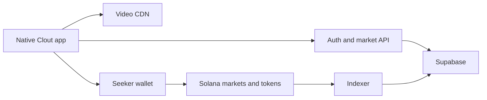

# Clout build plan

Prepared October 12, 2026. Hackathon scope: 5–7 days, 2–3 builders. Status: source implementation and preview APK built; live setup and release gates tracked in [docs/acceptance.md](docs/acceptance.md).

**User decision, October 12, 2026:** SKR is the app currency for backing posts, selling, rewards and tips. SOL is used only for Solana network fees. Do not launch a separate CLOUT platform token. The slogan is **Seek the best content, win SKR**. This decision supersedes the earlier SOL/CLOUT proposal.

**Current alpha requirements:** Mobile is the primary experience. Use vertical TikTok-style paging, the Seeker's 40:89 video ratio, safe-area controls and accessible touch targets; review native phone layouts before treating desktop polish as complete. Bundle at least 50 licensed posts and create at least 30 real devnet markets. Run the entire app on devnet, show an Early alpha notice, and expose Mint mock SKR in the sidebar and phone navigation. This faucet grants 1,000 mock SKR once per wallet, capped at 100 wallets; mainnet SGT-based eligibility and identity reads stay disabled. Profile supports up to three combined X/Fomo account slots for automatic imports from authorized accounts. Fomo activation depends on identifying its actual supported API. These requirements supersede earlier network and reward assumptions below.

Build Clout as a native Seeker app where people discover memes, back posts, and prove they spotted a trend early. The core experience is:

**Swipe → back a post → see your position → sell → creator receives fees → share your early-backer card.**

This plan covers the product, token economy, native app, backend, launch sequence, team allocation, and demo. It incorporates parallel Giggles research, video analysis, and adversarial review of the key product and architecture decisions.

**The reference experience establishes the interactions.** The supplied walkthrough shows three connected loops:

| In the recording                                     | What makes it compelling                   | Clout treatment                               |
| ---------------------------------------------------- | ------------------------------------------ | --------------------------------------------- |
| Video feed, backing, charts, buy/sell                | Your taste becomes a position              | Core hackathon experience                     |
| Investment badges in comments, profiles and rankings | Being early becomes public status          | Include                                       |
| Cards, crates, collections, auctions and trading     | Ownership becomes something fun to display | Ship collection/reveal; expand commerce later |

Giggles' September release notes say cryptocurrency features were removed except withdrawals. The recording demonstrates an Aura economy, but does not establish its pricing formula or that its cards are onchain NFTs. The narrator uses “NFTs” for the cards; the visible interactions alone do not prove blockchain ownership. Clout's economics below are a proposed implementation. [Giggles release history](https://apps.apple.com/us/app/giggles-videos-trends/id6740692268)

The local evidence is preserved in:

- [Reviewed Portuguese transcript](research/giggles-transcript.pt-BR.txt), with uncertain passages marked where narration overlaps the videos' audio.
- [Screen-by-screen observations](research/giggles-video-observations.txt).
- [Feed and market screenshots](research/giggles-feed-and-markets.jpg).
- [Cards and auctions screenshots](research/giggles-cards-and-auctions.jpg).
- [Collection and profile screenshots](research/giggles-collection-and-profile.jpg).

Source recording: `/Users/linrabei/Downloads/RPReplay_Final1791843947.MP4`, approximately 4 minutes 15 seconds.

**The first session starts with entertainment.** The app opens directly into the feed. Wallet connection happens when someone wants to participate:

1. Watch several short videos without onboarding.
2. Tap **Back this** on a post.
3. Connect the Seeker wallet; resolve the user's `.skr` identity and verify Seeker eligibility.
4. Choose a small SKR amount, inspect the quote, and approve the wallet transaction.
5. Return to the same video with a confirmed position and an early-backer badge.
6. Open Collection to see the post represented as a card, with entry price, current holdings and an executable sell estimate.
7. Share the card or sell some of the position. The creator can claim accumulated trading fees.

Use five tabs:

| Tab            | Hackathon functionality                                                |
| -------------- | ---------------------------------------------------------------------- |
| **Feed**       | Vertical video, likes, comments, position badges, backing button       |
| **Discover**   | Fresh posts, rising posts, creators and Seeker activity                |
| **Create**     | Camera-roll upload, caption, thumbnail, explicit market launch         |
| **Collection** | Holdings as visual cards, portfolio, sell, shareable receipts          |
| **Profile**    | `.skr`, Seeker badge, posts, reputation, creator earnings, SKR balance |

The visual direction is dark and video-first, with bright trade accents and tactile card reveals. Concentrate animation effort on opening the market sheet, confirming a successful backing, and revealing a collection card.

The feed needs preloading, one active video player, and reliable restoration after wallet signing. Expo's native video component supports preloading and caching. [Expo Video](https://docs.expo.dev/versions/latest/sdk/video/)

**Use SKR for post markets, rewards and tips.**

| Component       | Role                                                                                   |
| --------------- | -------------------------------------------------------------------------------------- |
| **SKR**         | What users spend and receive when trading posts; funded rewards and creator tips       |
| **Post tokens** | Actual wallet-held positions in individual post markets                                |
| **SOL**         | Solana network fees and account rent only; never the app's trading or rewards currency |
| **Reputation**  | Nontransferable recognition for participation and early discovery                      |

SKR is an existing token. Read its mint, token program and decimals from verified configuration for the selected network. Never infer the mint from a ticker or substitute a different token. On devnet, use a configured test SKR mint and label it **test SKR** throughout transaction and funding flows; it has no claim on mainnet SKR. Mainnet transactions and deployment require the user's explicit go-ahead.

Use Meteora Dynamic Bonding Curve for each launched post, followed by its DAMM v2 pool after graduation. Existing market infrastructure removes custom trading math and reserve accounting from the hackathon critical path. Meteora supports configurable quote tokens, creator fees and migration. [Meteora DBC](https://github.com/MeteoraAg/dynamic-bonding-curve)

Uploading a video and launching its market are separate actions. The current alpha requires **at least 50 curated clips and 30 real devnet markets**. The feed gets variety while a small audience concentrates in markets with visible activity.

A market launch should:

- Associate the post ID with its token mint, pool and creator wallet.
- Create a fixed-supply SPL post token using a shared Clout market configuration.
- Attach the post's thumbnail and canonical link to its metadata.
- Enable backing once the launch transaction confirms.
- Route subsequent trades according to whether the market is on DBC or DAMM v2.

Views influence discovery; buying and selling determine market prices. More views can attract buyers, but views must never directly manufacture redeemable gains.

Propose a fixed **1% total trading fee**. Under DBC's documented protocol split, dividing the remaining fee equally between creator and Clout produces approximately:

| Recipient | Percentage of trade amount |
| --------- | -------------------------: |
| Meteora   |                      0.20% |
| Creator   |                      0.40% |
| Clout     |                      0.40% |

This example applies to the proposed DBC configuration. Graduated-pool fees require their own explicit configuration. Creator earnings must be claimable from the actual fee mechanism. Portfolio values should use fresh sell quotes, accounting for fees and price impact. [DBC fee formulas](https://docs.meteora.ag/core-products/dbc/formulas)

Graduation is part of the implementation. Detect market state, execute or observe migration, and route trades to DAMM v2 afterward. Test a deliberately low-threshold graduation and a subsequent sell. Meteora keeper coverage has network and configuration conditions; devnet or unusual configurations must not assume automatic migration. [DBC developer guide and keeper conditions](https://github.com/MeteoraAg/docs/blob/main/developer-guides/dbc/index.mdx)

**SKR rewards have a concrete, bounded funding plan.** Clout does not create or control SKR's mainnet supply, allocations, vesting or token authorities. Campaigns and tips transfer existing, funded SKR; they do not mint a proprietary platform currency or manufacture redeemable rewards from views.

| Network     | Funding and token policy                                                                                  |
| ----------- | --------------------------------------------------------------------------------------------------------- |
| **Devnet**  | Configured test SKR mint with verified decimals and explicit test labeling                                |
| **Mainnet** | Verified existing SKR mint; rewards funded from a designated treasury; launch and budget require approval |

During the hackathon, demonstrate:

- A configured devnet test SKR mint with metadata and funded test wallets.
- One bounded Seeker claim campaign.
- A test SKR tip from one wallet to another.
- A balance and transaction history inside the app.

For the devnet example only, cap the campaign at **100 eligible Seeker claims × 1,000 test SKR**, totaling 100,000 test SKR. Mainnet reward amounts are a separate funded budget decision, not implied by these test figures. Use the SGT mint as the claim identifier so moving it to another wallet cannot repeat the claim. Rewards come from the funded campaign budget; ordinary scrolling earns reputation. Claim retries must reconcile transaction status and avoid duplicate payments.

The eventual mainnet sequence is:

1. Obtain explicit approval for the mainnet launch and funded campaign budget.
2. Verify the existing SKR mint, decimals, token program and supported account behavior.
3. Fund designated SKR treasury and campaign accounts plus SOL for network fees.
4. Configure and verify SKR-quoted post markets and graduated pools.
5. Integrate SKR acquisition or wallet funding instructions without silently swapping another asset.
6. Verify market launches, trading, creator claims and reward reconciliation.
7. Activate bounded, funded SKR reward campaigns.

Clout does not create a new mainnet SKR mint, alter SKR authorities or launch a CLOUT/SOL pool. Any post-token mint authorities belong to the separate market-launch configuration and must be verified there.

**Keep the technical stack small.**

| Layer               | Choice                                                                 |
| ------------------- | ---------------------------------------------------------------------- |
| Native app          | React Native, Expo development build, TypeScript, Expo Router          |
| Solana client       | `@solana/kit`, Wallet UI, Mobile Wallet Adapter                        |
| Video               | `expo-video` and Cloudflare Stream                                     |
| Social backend      | Supabase Postgres, authentication/session integration, Realtime        |
| Market API          | Small Node/TypeScript service using Meteora's SDK                      |
| Indexing            | Transaction ingestion, deduplication and periodic chain reconciliation |
| Collectible stretch | Metaplex Core                                                          |
| Delivery            | Signed APK, installed and tested on a physical Seeker                  |

Start from the maintained `expo-kit-wallet` template. MWA requires native modules, so development uses an Android build. Meteora's SDK currently uses `web3.js`; keep that dependency inside the market service while the mobile app uses Kit. [Solana Mobile CLI](https://github.com/solana-mobile/solana-mobile-cli), [Meteora SDK](https://docs.meteora.ag/developer-guides/dbc/typescript-sdk/getting-started)

The backend stores profiles, posts, comments, follows, watch events, market mappings, indexed trades and reward eligibility. Wallets and Solana remain authoritative for ownership and settlement. Keep privileged credentials on the server and restrict client access to social and profile data through appropriate authorization.

For uploads: the API issues a direct upload URL, the phone uploads to Cloudflare, and a processing callback makes the post available with its playback URL and thumbnail. [Cloudflare direct uploads](https://developers.cloudflare.com/stream/uploading-videos/direct-creator-uploads/)

For trades: fetch a fresh quote → build the transaction → sign through MWA → display pending → confirm onchain → update the portfolio. Cancellation, expiry and retries need explicit states. Early-backer badges derive from confirmed purchase history; receiving transferred tokens does not establish early participation.

**Make Seeker visible in the experience.**

- Native wallet signing, with the feed preserved across wallet interaction.
- `.skr` identity throughout comments, positions and creator pages.
- Verified Seeker benefits, such as the starter claim and special creator drops.
- Native sharing, uploads and haptics that make participation feel immediate.

Use a server-issued, short-lived, single-use sign-in challenge to verify wallet ownership. Perform SGT verification on the server afterward. SGT establishes Seeker eligibility, not unique-human identity. Public post-token markets remain accessible outside Clout; Seeker-specific benefits live in the app and reward rules. [Seeker verification](https://docs.solanamobile.com/recipes/general/detecting-seeker-users)

The current user-directed alpha is **devnet only, including runtime reads**. Mainnet SGT checks and `.skr` resolution are disabled; do not claim Seeker verification in this alpha. Verify the installed Seeker wallet's actual devnet behavior. MWA supports devnet, but that alone does not establish the installed Seed Vault Wallet's devnet flow. If a separate development wallet is needed, explicitly verify its relationship to the identity wallet. Wallet authorization does not imply silent approval of subsequent trades.

**Preserve the collectible moment within the build window.** In the core build, collection cards visually represent positions and purchase receipts. Add one excellent reveal animation and a shareable “I backed this early” card. These receipts are not separate NFT assets.

With three builders and seven days, add one actual Genesis collectible through Metaplex Core. Cut this stretch first if trading, fee claims, migration handling or device polish remains unfinished. Full crate inventories, auctions and peer-to-peer card trading belong in the next release. [Metaplex Core](https://www.metaplex.com/docs/smart-contracts/core)

Later product expansion can include clans, direct/group messaging, additional collectibles, auctions, packs, livestreaming and AI creation tools. They should build on an already reliable feed and transaction experience.

**Adversarial review favors fewer economic dependencies.**

| Challenged decision                 | Resolution                                                                           |
| ----------------------------------- | ------------------------------------------------------------------------------------ |
| Build our own bonding curve         | Use existing DBC infrastructure                                                      |
| Introduce a separate platform token | Use existing SKR throughout; disclose SKR funding and keep SOL for network fees only |
| Give every upload a market          | Concentrate the pilot into 5–10 markets                                              |
| Reward trading volume               | Use capped campaigns; volume rewards invite circular trading                         |
| Copy every Giggles feature          | Prioritize playback, complete trading and collection polish                          |
| Assume graduation handles itself    | Implement and test migration and post-graduation selling                             |

The strongest objection is that Clout could become a token launchpad with videos attached. Keep entertainment central: rank primarily by engagement, freshness and discovery; keep financial details in the backing sheet; make following creators and sharing discoveries useful without buying.

SKR-quoted post markets are required for this build. Verify quote-token support, liquidity, decimals, fees and graduation behavior before enabling trades. If the trading integration cannot meet the early device gates, keep it explicitly unavailable and expose only a clearly labeled preview; do not substitute SOL, CLOUT or points for SKR without a new user decision.

**Run three implementation lanes in parallel.**

| Builder                 | Ownership                                                                           |
| ----------------------- | ----------------------------------------------------------------------------------- |
| **A — Mobile**          | Feed, navigation, wallet return, trade sheet, collection and polish                 |
| **B — Chain**           | SKR market configuration, launch/buy/sell/claim, funded rewards and tips, migration |
| **C — Backend/product** | Identity, uploads, indexing, social features, seed content and demo                 |

With two builders, combine backend and chain work and drop the Genesis NFT stretch. Review the market design and token parameters adversarially before freezing them, then review transaction recovery and the complete device demo before release.

| Day   | Deliverable                                                                            |
| ----- | -------------------------------------------------------------------------------------- |
| **1** | App running on Seeker, smooth sample feed, wallet authentication and transaction spike |
| **2** | Two-wallet create/buy/sell/fee-claim flow; freeze market configuration                 |
| **3** | Upload pipeline, real feed, profiles, market indexing and charts                       |
| **4** | Comments, positions, collection, SGT/.skr, test SKR claim and tip                      |
| **5** | Graduation and post-graduation sell; retries, duplicate events and recovery            |
| **6** | Seed content, native polish, release APK; optional Genesis collectible                 |
| **7** | Device testing, demo rehearsal, recording and submission                               |

The signed APK is the judging deliverable. Prepare dApp Store submission in parallel; review timing is an external dependency. [Solana dApp Store submission](https://docs.solanamobile.com/dapp-store/submit-new-app)

Acceptance requires the complete flow on a physical Seeker: usable feed, wallet sign-in, accurate buy/sell settlement, creator fee claim, indexed holdings, clear cancellation and failure recovery, a bounded reward claim, and a release APK. Check duplicate transaction events, app restart during a pending trade, expired quotes, and a migrated market. Cosmetic polish follows these economic and device gates.

**The final demo takes about two minutes.** Open Clout, discover a post, back it with the Seeker wallet, show the position, have a second wallet participate, sell part of the first position, claim the creator fee, then reveal and share the early-backer card. Every economic step corresponds to a real transaction on the clearly identified demo network.
